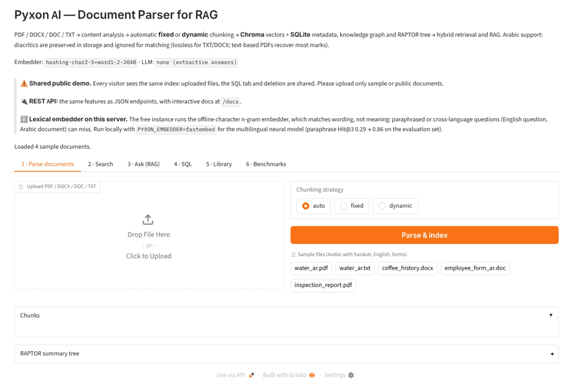

# Pyxon AI — Arabic-aware Document Parser for RAG

My solution to the [Pyxon AI junior engineer entry task](TASK.md): a document parser that reads **PDF, DOCX, DOC and TXT**, works out the document's structure, **chooses fixed or dynamic chunking on its own**, and stores the results in a **vector DB (Chroma)** and a **SQL DB (SQLite)**. It also adds a term co-occurrence graph, a RAPTOR-style summary tree, hybrid retrieval, a RAG layer, **OCR for scanned PDFs**, **Arabic light stemming** and a **REST API**. Arabic text, including **harakat/tashkeel**, is kept exactly as written in storage while matching ignores diacritics: lossless for TXT/DOCX/DOC, and for text-based PDFs as good as the PDF's own text layer allows (89% of marks on the sample PDF, 100% of letters).



```
             ┌──────────────┐   ┌────────────────┐   ┌──────────────────────┐
 PDF/DOCX ──▶│   loaders    │──▶│    analyzer    │──▶│  Fixed  | Dynamic    │
 DOC/TXT     │ PyMuPDF+pypdf│   │ structure,lang,│   │ chunker | chunker    │
             │ python-docx  │   │ harakat, score │   │ (window)| (sections +│
             │ LibreOffice  │   │ → strategy     │   │         |  semantic) │
             └──────────────┘   └────────────────┘   └─────────┬────────────┘
                                                               ▼
           ┌──────────────────────────── embed (multilingual) ────────────────┐
           ▼                         ▼                          ▼             ▼
   Chroma (vectors)        SQLite: documents,         Knowledge graph   RAPTOR tree
   leaf + summary nodes    sections, chunks, FTS5     (terms, edges,    (k-means →
                           BM25, terms, edges         PageRank)         summaries)
           └───────────────┬─────────┴──────────────────────┘
                           ▼
          Hybrid retriever (vector + BM25 + graph, RRF fusion)
                           ▼
          RAG: SQL router for structured questions · grounded LLM prompt · extractive fallback
```

## Features

| Requirement | How it is done |
|---|---|
| PDF | **PyMuPDF** for layout blocks and font sizes, so headings are detected from font size. **pypdf** is a second extractor. For each page, the loader keeps whichever output is *less garbled* (`arabic_garble_score`), because some Arabic PDFs only extract in logical order with one of the two. Arabic presentation forms (U+FB50–U+FEFF) are NFKC-normalized back to base letters. |
| Scanned PDF (OCR) | A page with no text layer but with images is rendered at 300 dpi and read with **Tesseract** (`ara+eng`), which returns Arabic in logical order. On the scanned Arabic sample: **99.9% character similarity, 98.4% word recall**, about 1 s per page. A blank scan still gets a clear error. Needs the `tesseract` binary with Arabic data (installed in the Docker image); without it, scans are rejected with an install hint |
| DOCX | python-docx with **heading styles** (Heading 1–n / Title) as structure. Paragraphs and tables are read **in document order**, so a table stays under its heading; each table row becomes one sentence with its column headers (`Item: Alpha, Price: 17 dinars.`) |
| DOC | Converted headlessly with LibreOffice (`soffice --convert-to docx`), then parsed as DOCX |
| TXT | BOM → UTF-8 → legacy Arabic codecs. Windows-1256 accepts almost any byte, so **Windows-1256 and ISO-8859-6 are both tried and the more plausible Arabic wins** (accented Latin letters inside Arabic words reveal the wrong codec). `load_document(path, encoding=...)` overrides detection |
| Content understanding | `analyzer.py` detects headings (styles, font size, markdown, `Chapter/Section`, `الفصل/الباب/القسم`, numbering, short-title heuristics), paragraph and section length variance, `key: value` form fields, language, text direction, diacritic density, TF-IDF keywords and an extractive summary |
| Strategy choice | A transparent weighted score (headings +, uneven sections +, varied paragraphs +, form fields −, very short −). The UI and DB store the *reasons* (e.g. "5 headings detected → structure-aware splitting keeps sections intact") |
| Fixed chunking | ~120-word windows that only cut at sentence boundaries, with ~20 words of sentence overlap |
| Dynamic chunking | Sections first: a chunk **never spans two sections** and **never exceeds `max_size` words**. Long sections are split where meaning shifts (similarity between neighbouring sentence windows drops below a percentile of the section); too few sentences to measure → size-only packing. Small fragments merge only into a chunk of the same section; a short section keeps its own heading. Each chunk keeps the page of its first sentence |
| Vector DB | **Chroma** (persistent, cosine HNSW) with chunk metadata. **One collection per embedding model** (name + recorded model and dimension); opening an index with a new model re-embeds the chunk texts stored in SQLite automatically (`parser.reindex()`), so vectors from different models never mix. In-memory parsers get a private UUID collection |
| SQL DB | **SQLite**: `documents`, `sections`, `chunks`, `chunks_fts` (FTS5/BM25), `terms`, `term_edges` |
| Consistency | Ingestion is **atomic across both stores**: embeddings and summaries are computed first, SQL rows are written in one transaction that commits only after the vectors are stored, and a failure rolls SQL back and removes partial vectors. Re-ingesting a file replaces the old version only once the new one is fully written |
| Arabic | Original text is always stored. A normalized form (no harakat or tatweel; unified أ/إ/آ/ٱ→ا, ى→ي, ة→ه, ؤ/ئ; Arabic-Indic digits; ال removed) is used for embeddings, BM25 and the graph. **Light stemming** (Light10-style: و, ال/لل/بال prefixes and ات/ون/ين/ها/ة suffixes) plus the commonest broken plural (أفعال: الأمطار → مطر) go into a **second FTS5 column weighted 0.5**, so المعلم finds المعلمون and للمياه finds المياه while exact words still rank first. RTL text is rendered with `dir="auto"` in the demo |
| Graph RAG (lightweight) | A **term co-occurrence graph** per document: TF-IDF key terms per chunk are nodes, co-occurrence in a chunk is an edge, PageRank gives key concepts. At query time, query terms are expanded **one hop** to related terms. No entity extraction or community summaries |
| RAPTOR-style tree | Leaf embeddings are clustered with **k-means**, each cluster gets an **extractive** summary (or an LLM summary with `PYXON_LLM_SUMMARIES=1` and an API key), and the process repeats up to a root. Summary nodes are stored as `level ≥ 1` for "collapsed tree" retrieval |
| Hybrid retrieval | Vector + BM25 + graph rankings fused with weighted **Reciprocal Rank Fusion**. Every hit shows which retrievers found it and at what rank. The same passage indexed from two files (e.g. `book.txt` and `book.pdf`) is shown once, with the other file listed under *also in* |
| REST API | **FastAPI** (`pyxon_parser/api.py`): upload, list, get, delete documents; search; ask; read-only SQL; health. Served by the same process as the demo (UI at `/`, API at `/api`, interactive docs at **`/docs`**), or alone with `uvicorn pyxon_parser.api:app`. Optional `PYXON_API_KEY` protects upload and delete |
| RAG integration | `RAGPipeline.ask()` sends corpus-metadata questions to **SQL** through a small intent parser (`query_router.py`): a question goes to SQL only if *every* content word is metadata vocabulary (documents, chunks, counts, languages, file types, chunking strategy, diacritics), so "What is the marketing strategy for Zephyr?" still goes to search. Filters and document scope become a **parameterised** SELECT, and SQLite enforces read-only access with an authorizer. Everything else goes through retrieval, a cited prompt and an LLM (Anthropic or any OpenAI-compatible API via env vars). Without a key, an extractive answer quotes only sentences that cover the question well, or says it could not find the answer |

## Quick start

```bash
pip install -r requirements-dev.txt -c constraints.txt   # Python 3.11+; constraints = the tested versions
python app.py                            # demo on http://localhost:7860 (sample docs auto-load)
pytest                                   # 125 tests (unit, API, OCR, held-out documents, broken files, review regressions)
python -m benchmarks.run_benchmark       # writes benchmarks/results/results.{md,json}
```

Python API:

```python
from pyxon_parser import PyxonParser

parser = PyxonParser(data_dir="data")                 # SQLite + Chroma under ./data
res = parser.ingest("samples/water_ar.pdf")           # strategy="auto" | "fixed" | "dynamic"
print(res.analysis.strategy, res.analysis.reasons)

for hit in parser.search("سد مأرب", k=3):             # with or without harakat
    print(hit.filename, hit.section, hit.sources, hit.text[:80])

print(parser.ask("ما هي علامات الجفاف؟").answer)
print(parser.ask("How many documents are indexed?").rows)   # routed to SQL
```

REST API (same server as the demo; full schema at `/docs`):

```bash
curl -F file=@samples/water_ar.pdf http://localhost:7860/api/documents
curl -H 'content-type: application/json' -d '{"query": "سد مأرب", "k": 3}' http://localhost:7860/api/search
curl -H 'content-type: application/json' -d '{"question": "Which forklift failed inspection?"}' http://localhost:7860/api/ask
```

Configuration (environment variables):

| Variable | Default | Meaning |
|---|---|---|
| `PYXON_EMBEDDER` | `auto` | `hashing` (lexical, offline), `fastembed` (neural multilingual MiniLM via ONNX: `pip install fastembed`, ~220 MB model download, recommended for paraphrase and cross-language questions), `arabert` / `camelbert` (Arabic models suggested by the task, via `pip install sentence-transformers`; see the comparison below), or any sentence-transformers model name. `auto` tries `intfloat/multilingual-e5-small` through sentence-transformers and falls back to `hashing` |
| `PYXON_DATA_DIR` | `./data` | Where the demo keeps SQLite and Chroma |
| `ANTHROPIC_API_KEY` / `OPENAI_API_KEY` | none | Turns on LLM answers. `PYXON_LLM_MODEL` and `OPENAI_BASE_URL` are optional. (The API clients are implemented but were not exercised end to end with a real key for this submission.) |
| `PYXON_ARABIC_STEM` | `light` | `light` (stems + af'al plurals in the weighted column), `isri` (also NLTK ISRI roots; measured, no gain), or empty to disable |
| `PYXON_OCR`, `PYXON_OCR_LANG`, `TESSERACT_CMD` | `1`, `ara+eng`, auto | Turn OCR off, change its languages, or point to `tesseract.exe` on Windows (default `C:\Program Files\Tesseract-OCR\tesseract.exe`) |
| `PYXON_API_KEY` | none | When set, API upload and delete require the header `X-API-Key` |
| `PYXON_LLM_SUMMARIES` | `0` | `1` makes the RAPTOR tree use the LLM for cluster summaries (needs a key) |

## Live demo

**🔗 https://pyxon-document-parser-1n4n.onrender.com** (free tier: the first load after a quiet period takes about a minute while the server wakes up)

The same server also exposes the REST API, with interactive docs at [`/docs`](https://pyxon-document-parser-1n4n.onrender.com/docs). The Gradio app (`app.py`) has six tabs: parse (upload, analysis, chunks, RAPTOR tree), search (pick a retriever), ask (RAG), SQL explorer, library and benchmark results. The sample corpus loads at startup, and the Arabic files with harakat are one click away. It is a **shared** demo: every visitor sees the same index, SQL tab and delete button, so upload only sample or public documents. It runs the hashing embedder, because the free instance has 512 MB of RAM.

**Deploying (free) on Render:** New → Web Service → connect this repository → Language **Docker** → Instance type **Free**. The included `Dockerfile` installs LibreOffice (for `.doc` files) and Tesseract with Arabic (for scanned PDFs) and starts the app on the port Render provides. On the free tier the service sleeps after 15 minutes without traffic, so the first request after that takes about a minute while it wakes up. The same `Dockerfile` works on Railway, Fly.io, Google Cloud Run or a Docker Space on Hugging Face.

## Benchmarks

`benchmarks/run_benchmark.py` runs five sections. Full output is in [`benchmarks/results/results.md`](benchmarks/results/results.md). The headline numbers below come from the **offline hashing embedder** on a 2-vCPU container:

* **Strategy selection:** 9/9 files get the expected strategy (8/8 when LibreOffice is not installed and the `.doc` sample is skipped). This holds across formats: the same content as DOCX, PDF and TXT gets the same decision.
* **Retrieval** (29 queries: 13 English, 15 Arabic, 1 mixed, including vocalized and bare variants of the same question). nDCG uses every relevant chunk in the index as the ideal, not only the retrieved ones:

  | Corpus | Retriever | Hit@1 | Hit@3 | MRR@5 | nDCG@5 |
  |---|---|---|---|---|---|
  | TXT/DOCX/DOC | vector | 0.93 | 1.00 | 0.97 | 0.96 |
  | | keyword (BM25) | 1.00 | 1.00 | 1.00 | 1.00 |
  | | graph alone | 0.52 | 0.52 | 0.52 | 0.52 |
  | | **hybrid** | **0.97** | **1.00** | **0.98** | **0.99** |
  | PDF | **hybrid** | **0.97** | **1.00** | **0.98** | **0.99** |
* **Chunking quality:** dynamic chunking has a **0%** section-crossing rate, against 41% for fixed windows on the same documents. Every chunk ends exactly where a complete source sentence ends (the metric compares against the source sentences, so a forced cut inside a sentence counts as a failure; the tests check this). The coherence gap (within-chunk minus across-boundary similarity) is +0.14 for dynamic and −0.03 for fixed.
* **Performance:** 0.05–0.35 s to ingest each sample (about 0.8 s for the Arabic PDF, which runs two extractors). Python allocations stay under 3 MB per document; the whole process (Python, Chroma, models) uses about 310 MB RSS. Hybrid query p50 is about 3.6 ms. At **100 documents / 550 chunks**, ingest runs at about 38 docs/s and hybrid query p50 is about 10 ms.
* **Arabic:** all 1,298 harakat survive end to end (source = SQL = Chroma, for both TXT and DOCX). Vocalized and bare queries return the same top-1 (3/3 pairs, 4/4 single words). Normalization passes 10/10 cases, UTF-8, UTF-16, Windows-1256 and ISO-8859-6 all round-trip, and the Arabic PDF's bare text matches the source 100%. A **scanned** (image-only) Arabic PDF is read by OCR with 99.9% character similarity and 98.4% word recall.

All benchmark runs use isolated stores: every in-memory parser gets its own UUID collection, so no run can see another's vectors.

How to read these numbers: the corpus is small (4 documents per corpus, by design so that relevance can be labelled exactly), so retrieval scores are near their ceiling. The hashing embedder is lexical, which is why BM25 is so strong on its own. The benchmark is built so that switching to a neural embedder (`--embedder intfloat/multilingual-e5-small`) or adding harder query sets needs no code changes.

### Held-out evaluation (unseen documents)

The numbers above use documents that were in front of me while I built the parser. To check that it generalises, `benchmarks/heldout/` adds **documents and questions written afterwards, in styles it was not tuned on**: an Arabic data-protection law (المادة 1 … 7), an Arabic news article saved in **Windows-1256**, a fully **vocalized** Arabic story, a **bilingual** EN/AR DOCX with a table, a PDF product manual, a 41-chapter report, and seven **broken files** (corrupt PDF, fake DOCX, empty, whitespace-only, image-only "scanned" PDF, a 6,000-word single line, unknown extension).

A caveat: the set was unseen when it was written, but I have since used it to calibrate the neural filter (below) and to check fixes, so it is now a development set rather than a strictly held-out one. A frozen, larger test set is listed under future work.

```bash
python -m benchmarks.heldout.build_heldout   # builds the documents
python -m benchmarks.heldout.run_heldout     # writes benchmarks/heldout/results.md
```

| Check | Hashing embedder (default, offline) | Neural embedder (`PYXON_EMBEDDER=fastembed`) |
|---|---|---|
| Strategy selection | **8/8** | **8/8** |
| Questions sharing words with the answer (n=20) | Hit@1 0.95 · Hit@3 1.00 | Hit@1 0.90 · Hit@3 1.00 |
| Paraphrased questions (n=7) | Hit@1 0.43 · Hit@3 0.43 | Hit@1 0.43 · **Hit@3 0.86** |
| English question about an Arabic document (n=1) | miss | **rank 1** |
| All 28 questions | Hit@1 0.79 · Hit@3 0.82 · MRR 0.80 | Hit@1 0.79 · **Hit@3 0.96** · MRR 0.87 |
| Noise (results from a different document than the answer) | 25% | 22% |
| Broken files | **7/7** handled | **7/7** handled |

**Calibrating the hybrid filter for the neural model.** A result that only the vector search found is either a genuine paraphrase match or noise; the filter decides which to keep. Measured on the held-out set (Windows laptop, multilingual MiniLM):

| Rule for vector-only hits | Paraphrase Hit@3 | All Hit@3 | Noise |
|---|---|---|---|
| keep all | 1.00 | 1.00 | 34% |
| **vector top-2, cosine ≥ 0.15 (default)** | **0.86** | **0.96** | **22%** |
| cosine ≥ 0.3 | 0.71 | 0.93 | 25% |
| cosine ≥ 0.5 | 0.57 | 0.89 | 17% |

The default trades one paraphrase (of seven) for twelve points less noise; set `PYXON_VECTOR_KEEP_RANK=0 PYXON_VECTOR_MIN_SIM=0` to favour recall (e.g. when an LLM reads the results anyway) or `PYXON_VECTOR_MIN_SIM=0.5` to favour precision. The small multilingual model scores Arabic passages low (right answers sometimes below 0.25), which is why a pure cosine threshold does not work well and the hybrid design keeps BM25 for exact Arabic terms.

Broken files get a clear `DocumentLoadError` or `EmptyDocumentError` ("scanned PDF, needs OCR"), and nothing is half-indexed. The hashing column includes light stemming (before it: paraphrase Hit@3 0.29, all Hit@3 0.79, noise 28%). The neural column was measured on a Windows laptop with `paraphrase-multilingual-MiniLM-L12-v2` (quantized ONNX, 235 MB download) before stemming was added; the embedder comparison below re-measures it.

Caveat: these documents helped find bugs that are now fixed, so they are no longer a fully untouched test set, and 7 paraphrases plus 1 cross-language question are too few to prove broad generalisation. A frozen, larger set with distractors and unanswerable questions is the next step.

Running it on unseen documents found three real bugs, which are now fixed and covered by tests: legal articles (`المادة 3: …`) were mistaken for form fields, damaged files crashed with library errors, and image-only PDFs were "indexed" with zero chunks. It also shows the main limit of the offline hashing embedder: it matches words, not meaning. Switching to the neural embedder lifts paraphrased questions from Hit@3 0.29 (0.43 with stemming) to 0.86 and answers the cross-language question, with no loss on exact-wording questions, because hybrid retrieval still uses BM25 for exact terms and the neural vectors for meaning.

### Arabic stemming: what was tried

Same corpus and questions; "weighted" means the stems sit in a second FTS5 column that counts half as much as an exact word.

| Variant | Main benchmark hybrid Hit@1 / nDCG@5 | Evaluation set: paraphrase Hit@3 | All Hit@1 / Hit@3 | Noise |
|---|---|---|---|---|
| No stemming (before) | 0.97 / 0.97 | 0.29 | 0.75 / 0.79 | 28% |
| Light stems, same weight as words | 0.93 / 0.97 | 0.43 | 0.79 / 0.82 | 27% |
| ISRI roots, same weight as words | 0.97 / 0.99 | 0.57 | 0.71 / 0.86 | 28% |
| **Light stems, weighted 0.5 (default)** | **0.97 / 0.99** | **0.43** | **0.79 / 0.82** | **25%** |
| Light + ISRI roots, weighted 0.5 | 0.97 / 0.99 | 0.43 | 0.79 / 0.82 | 28% |

Unweighted stems help recall but push one exact-wording Arabic question to rank 2; full ISRI roots recall one more paraphrase but lose two top-1 answers (roots like كتب merge too many words). Weighted light stemming is the only variant that is at least as good as no stemming on every metric.

### Arabic-specific embedding models

The task suggests CAMeLBERT and AraBERT, so both are available as options and measured against the multilingual model on the evaluation set:

```bash
pip install sentence-transformers fastembed
python -m benchmarks.heldout.compare_embedders hashing fastembed arabert camelbert   # writes benchmarks/heldout/embedders.md
```

`arabert` is AraBERT v02 fine-tuned for Arabic sentence similarity (`Omartificial-Intelligence-Space/GATE-AraBert-v1`); `camelbert` is the raw CAMeLBERT-MSA encoder with mean pooling, included as a baseline because a model that was never trained for sentence similarity is a common mistake. Results: see [`benchmarks/heldout/embedders.md`](benchmarks/heldout/embedders.md).

## Independent review and fixes

An independent review of PR #19 scored it 76/100 and gave 18 reproducible checks; **4 passed**. Every finding below is fixed and covered by a regression test in `tests/test_review_fixes.py`; the reviewer's own script now passes **18/18**.

| Finding | Fix |
|---|---|
| New in-memory parsers could inherit old vectors (collection named after `id(self)`) | UUID collection per in-memory parser, `close()` / context manager; tested over 40 create/destroy cycles |
| A failed vector write left SQL rows without vectors; a failed replacement deleted the original | One SQL transaction committed only after the vector write; compensation on failure; old version removed only after the new one is complete |
| Dynamic chunking moved a short section into the next one and could exceed `max_size` | Merges stay inside a section; size-only packing for 1–2 units; pages kept per sentence |
| DOCX tables moved to the end of the document | Body read in order; table rows carry column headers |
| SQL routing: "Which documents are Arabic?" listed everything, "marketing strategy" went to SQL | Metadata-vocabulary intent parser with filters, counts and document scope; parameterised SQL |
| Switching embedding model on an existing index crashed search | One collection per model; automatic re-embedding from SQLite |
| Benchmark: boundary metric counted forced cuts as clean; nDCG ideal used retrieved hits only | Boundary checked against source sentences; ideal DCG from all relevant chunks; process RSS reported |
| ISO-8859-6 text decoded as Windows-1256 mojibake | Plausibility-scored codec choice + `encoding=` override |
| Heading-only files indexed nothing silently | Clear `EmptyDocumentError` |
| `WITH … DELETE … RETURNING` passed the read-only prefix check | SQLite authorizer allows only read actions |
| Extractive answers appended unrelated sentences | Rarity-weighted coverage, relative cut-off, "not found" below a minimum |
| Shared demo data, no CI, loose dependency bounds | Shared-demo banner; GitHub Actions (tests on Python 3.11/3.12, held-out run, Docker build); `constraints.txt` with tested versions; PyMuPDF ≥ 2.1 (1.26 segfaulted in the review environment) |

## Project layout

```
pyxon_parser/
  arabic.py      harakat handling, normalization, language/direction detection
  loaders.py     PDF (PyMuPDF + pypdf, Tesseract OCR for scans), DOCX, DOC (LibreOffice), TXT (encoding detection)
  analyzer.py    structure + content analysis, strategy scoring
  chunking.py    FixedChunker, DynamicChunker
  embeddings.py  hashing (offline), fastembed (ONNX) or sentence-transformers
  storage.py     SQLStore (SQLite + FTS5, transactions, read-only guard), VectorStore (Chroma, per-model collections)
  query_router.py  metadata questions -> parameterised SQL
  graph.py       concept graph (Graph RAG)
  raptor.py      hierarchical summary tree
  retrieval.py   hybrid retriever with RRF
  rag.py         SQL routing, prompt building, LLM / extractive answers
  llm.py         Anthropic / OpenAI-compatible client (env-configured)
  pipeline.py    PyxonParser facade
  api.py         FastAPI REST API (mounted under /api by app.py)
app.py           Gradio demo + REST API on one port
benchmarks/      queries.json, run_benchmark.py, results/, heldout/ (unseen-document evaluation)
samples/         sample corpus (EN/AR, vocalized Arabic, forms) + build script
tests/           pytest suite (125 tests)
docs/            demo.gif and the script that records it
.github/         CI: tests on Python 3.11/3.12, held-out evaluation, Docker build
```

## Design decisions and trade-offs

* **Keep the original text, match on the normalized text.** Removing harakat at ingest would make search easy but would destroy information (حَمَلَ vs حُمِلَ). Storing both forms keeps fidelity and also gives diacritic-insensitive recall.
* **An explainable heuristic for strategy choice, not a black box.** The choice depends on a handful of interpretable signals, so a reviewer (or the UI) can see why. An LLM classifier could replace `analyze()` without changing anything else.
* **Hashing embedder fallback.** The demo must run anywhere, including without GPU or Hugging Face access. A character n-gram and word hashing vectorizer on normalized text is stateless (documents can be added incrementally), works for Arabic morphology, and costs under 3 ms per query. With network access the default switches to multilingual-e5.
* **SQLite FTS5 for BM25** instead of a separate keyword index: one less service, and it stays in the same database as the metadata.
* **RRF fusion** instead of tuned score blending: robust to the very different score scales of cosine similarity and BM25.
* **Two PDF extractors** cost about 0.5 s per Arabic PDF, but they make Arabic PDFs readable when one extractor returns visual-order or broken text.
* **SQLite is the source of truth, Chroma is an index.** Chunk texts live in SQLite, so the vector index can always be rebuilt for a new model, and a write only becomes visible when both stores agree.

## Questions & assumptions

* *How is "intelligent" strategy selection judged?* → I assumed the decision must be automatic **and explainable**, and that a user can override it (`strategy=` / UI radio button).
* *Which embedding model?* → None was specified. I made the model pluggable, defaulted to multilingual-e5-small, and kept an offline fallback so the demo can't break.
* *Must an LLM be called?* → "Designed to integrate with a RAG system" suggested the LLM is pluggable. Answers use Anthropic or OpenAI when a key is present and extractive answers otherwise. No key is committed.
* *What counts as "structured queries"?* → Questions about the corpus itself (counts, languages, file types, strategies, chunk stats, diacritics) go to read-only SQL through the intent parser; anything mentioning document content goes to retrieval. Arbitrary SELECTs can be run in the demo's SQL tab.
* *Scanned (image-only) PDFs?* → Not required by the brief, but common for Arabic documents, so pages without a text layer go through Tesseract OCR (`ara+eng`) when it is installed.

## Limitations and future work

* Shadda inside lam-alef ligatures can be lost in some PDFs (89% of harakat recovered from the sample PDF; the bare text is 100% correct). DOCX and TXT are lossless.
* OCR uses Tesseract, which is good on clean printed Arabic but weaker on vocalized text, handwriting and low-quality scans; harakat in scans are not reliably recovered. Table structure in PDFs and image captions are not extracted.
* Arabic morphology is light: affixes and the af'al broken plural are handled, other broken-plural patterns (بحور, دروس, مساجد) are not. A full morphological analyzer (e.g. CAMeL Tools or Farasa) would cover them; ISRI roots were tested and did not help (table above).
* Heading detection in plain TXT is heuristic. An LLM-based structure pass could be added for messy documents.
* With the default offline embedder, paraphrased questions (Hit@3 0.29 on the held-out set) and cross-language questions are weak; `PYXON_EMBEDDER=fastembed` largely fixes both (paraphrase Hit@3 0.86, cross-language rank 1). The free Render instance (512 MB RAM) runs the hashing embedder; a paid instance or a machine with ~1 GB RAM can run the neural one.
* The public demo is shared and uses the hashing embedder; per-session isolation and a neural model need a larger instance.
* With more data: tune the RRF weights and dynamic-chunk thresholds on a labelled set, add a cross-encoder re-ranker (e.g. multilingual BGE reranker), and fine-tune an Arabic embedder on in-domain question-passage pairs.
